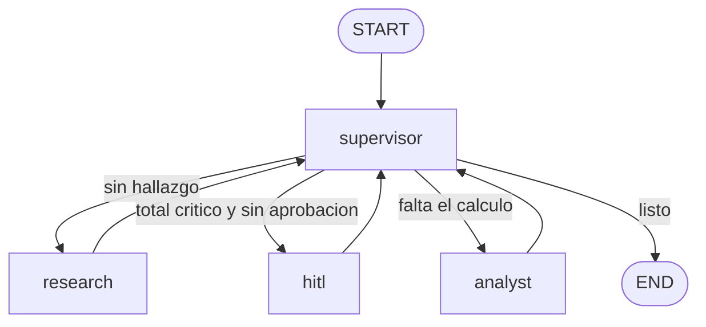

# API del orquestador con Redis y aprobación humana

FastAPI recibe el pedido, lo encola y devuelve un `job_id`. Un worker corre el orquestador del módulo 6. El estado del job y los checkpoints del grafo viven en Redis. Si el total del cliente es de 10000 o más, el grafo se pausa hasta `POST /tasks/{id}/approve`.

## Topología

El supervisor es el único router. Investigación busca el dato. Si el total es crítico, entra el nodo HITL y el grafo queda en `WAITING_APPROVAL`. Si el revisor aprueba, el analista calcula el ticket. Si rechaza, la respuesta es `Reembolso rechazado por el revisor`. A los 6 pasos el supervisor corta.



## Cómo levantarlo

Hace falta Redis Stack, no el Redis pelado: los checkpoints usan JSON y búsqueda. Python 3.12.

```bash
docker compose up -d redis phoenix
python3.12 -m venv .venv
source .venv/bin/activate
pip install -r requirements.txt
cp .env.example .env
```

`REDIS_URL` apunta a `redis://localhost:6380`. Completá `OPENAI_API_KEY` si querés que el modelo redacte y que el dashboard tenga costo y latencia. Sin esa clave, las herramientas igual responden y el HITL funciona.

```bash
uvicorn app.main:app --host 0.0.0.0 --port 8000
```

## Prueba

El cliente 7 tiene total 800: no es crítico y termina en `DONE`. El 102 tiene total 14500: queda en `WAITING_APPROVAL`.

```bash
curl -X POST localhost:8000/tasks -H "Content-Type: application/json" \
  -d '{"query": "Investigá cuántos pedidos tuvo el cliente 102 y el total, y decime si el ticket promedio supera 4000."}'
curl localhost:8000/tasks/<job_id>
curl -X POST localhost:8000/tasks/<job_id>/approve \
  -H "Content-Type: application/json" -d '{"aprobado": false}'
```

Cinco peticiones concurrentes:

```bash
python scripts/carga.py
```

Un `job_id` inventado responde 404. Si el worker falla, el estado pasa a `FAILED` con el error. No se queda en `RUNNING`.

## Observabilidad

Phoenix queda en http://localhost:6006. Para mandarle trazas, en `.env`:

```text
PHOENIX_ENABLED=1
OPENAI_API_KEY=...
```

LangSmith es la otra opción: `LANGCHAIN_TRACING_V2=true` y `LANGCHAIN_API_KEY`.

Después de las 5 peticiones, las capturas van en `screenshots/`: la traza, el costo por ejecución y la latencia p95. Esas dos métricas las calcula el dashboard con los tokens. Sin una corrida contra el modelo no aparecen, y no se inventan.

El checkpoint está en Redis. Podés bajar la API con un job en `WAITING_APPROVAL`, volver a levantarla y aprobarlo: el hilo sigue siendo el `job_id`.
